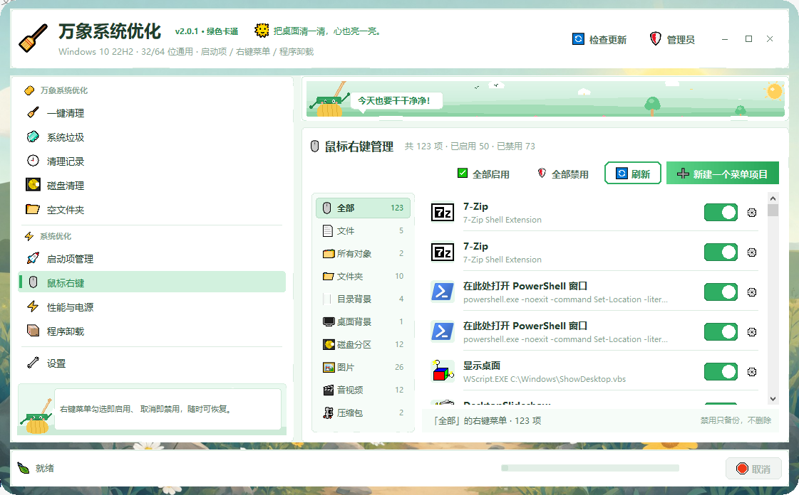
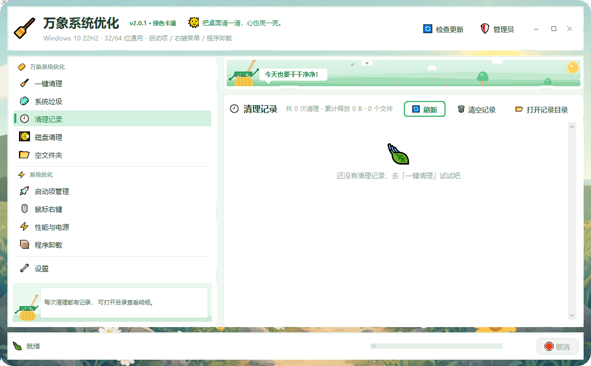

# 万象系统优化 · System Cleaner 🧹

绿色卡通风格的 **Windows 10 / 11 垃圾清理工具**，单文件 EXE、免安装、无广告、不联网。
**一个 32 位 EXE 通吃 Win10 / Win11 的 32 位与 64 位系统。**

C 盘又红了？点几下就能把临时文件、浏览器缓存、Windows 更新残留、崩溃转储这些"电子灰尘"扫干净。

---

## ✨ 功能

### 🧹 一键清理
- 点「开始扫描」先看能清多少，再点「推荐清理」
- **33 类系统垃圾**，按 **过期文件 / 系统相关 / 缓存文件 / 应用程序 / 临时文件 / 隐私** 六组显示
- 每类按 **推荐 / 可选 / 谨慎** 三档分级
- 一键清理只动「推荐」项：回收站、Windows.old 这类"删了就回不来"的永远要你自己勾

### 🧼 系统垃圾明细（v1.4.0 扩充到 33 类）
- 过期文件：被取代的 WinSxS 组件（DISM 按需清理）、Chrome / WPS 老版本备份、Windows.old、`$Windows.~BT`
- 系统相关：Windows 事件日志、Windows 更新安装记录、损坏的 Appx 应用包、系统还原点、零售演示离线内容
- 缓存文件：浏览器缓存、网页缓存、缩略图缓存、着色器缓存、WinINet Cookies、远程桌面缓存、.NET 程序集缓存、**微信 / 企业微信缓存**（新版 `xwechat_files` 也认）
- 应用程序：Package Cache 安装包缓存
- 临时文件：WinSxS 临时文件、Windows 日志、用户 / 系统临时文件、QQ / TIM 临时数据、回收站、崩溃 dmp、微软拼音无用文件
- 破坏性操作（DISM 清理组件、清事件日志、删还原点、删 Appx）都会先弹确认，删 Appx 前还要求系统里至少有 15 个应用包

### 🚀 启动项管理（v1.4.0 新增）
- 自动扫描 **当前用户 + 所有用户** 两条注册表 Run 键（含 32 位视图）和两个启动文件夹
- 每条显示名称、启动命令、来源、当前状态，**勾选即启用、取消即禁用**
- 禁用不删除任何东西：注册表项备份到 `HKCU\Software\SystemCleaner\StartupDisabled`，
  启动文件夹里的文件挪到 `%APPDATA%\SystemCleaner\StartupDisabled`，随时勾回来即恢复
- 支持「全部启用 / 全部禁用」，HKLM（所有用户）项需要管理员权限

### 🖱 鼠标右键管理（v1.5.1 新界面）
- 左侧**分类导航**（带数量）：全部 / 文件 / 所有对象 / 文件夹 / 目录背景 / 桌面背景 / 磁盘分区 / 图片 / 文档 / 音视频 / 压缩包 / 程序 / 发送到 / Win+X
- 右侧列表每行：图标、菜单名称、启动命令、**绿色胶囊开关**；点开关立即启用 / 禁用，新开资源管理器窗口就生效
- 行尾 **⚙ 齿轮**：查看执行命令、注册表位置（或文件 / 备份位置），一键复制
- **➕ 新建一个菜单项目**：选作用范围、填名称与命令即可写入当前用户；自建项可在齿轮里永久删除
- 「全部启用 / 全部禁用」只作用于当前分类，底部状态栏显示当前分类与项数
- 禁用不做破坏性删除：整棵注册表子树（含 `REG_DWORD` / `REG_BINARY` / `REG_MULTI_SZ`）备份到
  `HKCU\Software\SystemCleaner\ContextMenuDisabled`，拨回来原样恢复；发送到 / Win+X 的快捷方式移到备份目录
- 「打开 / 打印 / 编辑 / 固定到开始屏幕」等系统必需项自动隐藏；CLSID 尽量解析成软件名
- `所有用户`（HKLM）项需要管理员权限；按 64 位视图读取，看到的就是资源管理器右键里有的

### 📦 程序卸载（v1.5.4 新增，v1.5.6 修复扫描卡死，v1.5.7 排序与体积补全，v1.5.8 卸载后进度窗）
- 列出「应用和功能」里的程序：真实图标、版本、发布者、占用大小、安装日期；搜索框按名称 / 厂商 / 安装路径筛选
- **点「大小」/「安装时间」排序**，再点一次切换升降序（默认降序）；点行内的体积或日期文字也能排序，重排时保留选中项
- 缺少 `InstallDate` 时用卸载键写入时间兜底；缺少 `EstimatedSize` 时后台按安装目录估算体积（带时间预算，不卡界面，估算值标「≈」）
- **每次卸载结束都会自动分析**：程序是否已从列表移除、注册表 / 安装目录 / 快捷方式 / 应用数据还有哪些残留
- 残留体积统计带时间预算（单目录 6 秒 / 整体 15 秒，可随时取消），超大目录也不会卡住界面；
  厂商公共目录只匹配内部产品子目录，不会整包误删
- 「卸载结果分析」报告：程序状态、注册表残留、文件残留三块统计 + 残留预览；可一键清理、重新检查或强制删除
- 清理残留后自动再复核一次，明确显示是否真的清干净
- 应用数据默认保留（聊天记录 / 浏览器配置 / 游戏存档可能在里面），确认不需要再勾选删除

### 🎨 卡通界面（v1.5.5）
- 窗口与页面背景换成**山谷草地插画**：按 cover 居中裁切铺满，页面底图叠白纱，白卡片更清爽
- **窗口放大 / 缩小 / 最大化时按新尺寸实时重绘适配**，不拉伸、不模糊；图片缺失时自动退回手绘风景
- 内容区顶部手绘卡通横幅：扫帚吉祥物、云朵、山丘、小花；左侧导航底部还有吉祥物气泡提示
- 矮窗口自动收起横幅、窄窗口自动收紧按钮，10 个导航项与页面内容始终完整可见
- 卸载确认 / 结果分析 / 清理复核都是自绘无边框圆角弹窗，带标题条、关闭按钮，可拖动
- **卸载选中**：调用程序自带卸载器；结束后自动复查列表，仍在则提示改用**强制删除**
- **卸载后残留检查**：自动扫描注册表项、安装目录、快捷方式、应用数据，弹窗按三类开关逐条「将清除 / 保留」，
  一键清除选中项；**应用数据默认保留**，避免误删聊天记录 / 浏览器配置 / 游戏存档
- **强制删除**：卸载记录 + 注册表残留 + 安装目录 + 应用数据 + 快捷方式一次清掉，执行前二次确认
- 右键菜单：卸载 / 强制删除 / 删除列表条目 / 打开注册表条目 / 打开安装文件夹 / 程序网站 / 在网上搜索 / 刷新
- 受保护目录拒绝删除、不跟随 junction / 符号链接，被占用文件自动跳过并计数

### 💽 磁盘选择
- 想清哪个盘就勾哪个盘，扫描和清理只针对所选磁盘
- 每个盘显示卷标、文件系统、已用 / 总量、使用率进度条

### 📂 空文件夹筛选
- 扫描指定目录（或 C: / D: / E: 快速切换）下的空文件夹
- 默认跳过 Windows、Program Files 等系统目录
- 只要目录树里还有一个文件，整支都不动

### ⚡ 性能与电源（左侧导航 ⚡）
- **虚拟内存移到 D 盘**：把 pagefile.sys 从系统盘搬到数据盘，重启后生效，C 盘立刻多出几个 GB
  （v1.2.1 起会先检测分页文件当前在哪个盘，已经不在系统盘就直接提示「不需要转移」）
- **关闭睡眠**：睡眠 / 休眠超时全部设为「从不」，挂机下载、远程连接不再断
- 两者都只改系统设置，随时能在 Windows 里改回来；搬移前会自动备份原设置

### 🔄 自动升级（v1.2.0）
- 启动后静默检查一次新版本，**更新源：Gitee 主源 → GitHub 镜像**自动回退
- 也可以手动点「检查更新」，有新版会显示更新说明，一键下载后**覆盖原主程序**并自动重启
- 升级后**路径、文件名都不变**：不新增快捷方式、不生成第二个 EXE，原快捷方式打开就是新版本
- 下载支持 `sha256` 校验，文件不完整会自动换源重下

### 🎨 界面
- 左侧导航按 **系统清理 / 系统优化 / 设置** 三组排列（v1.5.4）
- 绿色卡通主题 + 圆角卡片 + 胶囊按钮 + 彩色 emoji
- 版本号后显示**每日祝福短句**：30 条长短句按日期轮换（同一天固定），emoji 为内嵌真彩色 PNG，背景保持默认卡片色
- 半透明、圆角可开关；**全程无边框**，标题直接放在主题头部里，最小化 / 最大化 / 关闭按钮自绘
- 后台线程扫描 / 清理，界面不卡死

### 🪟 系统兼容
- **32 位单文件，32/64 位通用**：一个 EXE 覆盖 Windows 10 / 11 的两种系统架构
- **Windows 11 原生适配（v1.5.5）**：DWM 原生圆角 + 系统阴影 + 无色边框，识别 24H2 / 25H2；
  支持 `Win+Z` 贴靠布局与 `Win+←/→/↑` 快速分屏；125% / 150% 高分屏下最小窗口不超出屏幕
- Win11 右键菜单默认折叠传统项，本程序管理的项在「显示更多选项」；商店应用请在「设置 → 应用」卸载
- 32 位系统缺少 `SetWindowLongPtrW` / `GetWindowLongPtrW`，v1.4.0 已补上 32 位回退，**32 位 EXE 同样没有系统标题栏**
- 任务栏图标按程序 ID 分组，Win11 固定到任务栏也不丢图标

---

## 📥 下载

| 来源 | 地址 |
|---|---|
| Gitee（更新源） | <https://gitee.com/wenming760/system-cleaner/releases/download/v2.0.1/SystemCleaner.exe> |
| GitHub | <https://github.com/wenming758/system-cleaner/releases/download/v2.0.1/SystemCleaner.exe> |

单文件 32 位 EXE（约 12 MB），不需要安装 Python 或运行库，拷贝到哪都能跑；32 位 / 64 位 Windows 10 / 11 都直接可用。
右键「以管理员身份运行」体验最完整（清 Windows 更新缓存、系统日志需要管理员权限）。

---

## 🖼 截图

| 首页 | 磁盘清理 |
|---|---|
|  |  |

| 系统垃圾 | 空文件夹 |
|---|---|
|  |  |

| 启动项管理 | 鼠标右键管理（彩色程序图标） |
|---|---|
|  |  |

| 性能与电源 | 清理记录 |
|---|---|
|  |  |

| 设置 |
|---|
|  |

---

## 📝 更新日志

### v2.0.1（2026-11-02）
- ➕ 右上角新增「检查更新」，更新源固定 Gitee，检查更快
- 🪟 修复弹窗可能被主窗口盖住、导致无法操作的问题：所有弹窗始终位于主窗口之上（主窗口不置顶）
- 🏷 **正式更名为「万象系统优化」**，主程序文件名为 `万象系统优化.exe`
- ➕ **新增拖拽添加程序**：把 .exe / 快捷方式 / 程序文件夹直接拖进窗口，自动分析版本、体积、注册表与残留候选，确认后加入程序列表，可像普通程序一样卸载、查残留
- 🐛 **修复拖拽后程序闪退**
- 📦 **新增程序卸载页**：真实程序图标、体积与安装日期排序、卸载后自动检查是否卸载完全并列出注册表 / 文件残留
- 🪟 窗口四边四角可自由缩放；主窗口和弹窗均不置顶
- 📝 补全 EXE 版本与著作信息（作者：万象乱谈），修正任务管理器显示的程序图标

### v1.5.8（2026-11-02）
- 🪟 **窗口可自由缩放**：四边和四角都能拖动调整大小，鼠标靠近边缘自动变成双向箭头；最小尺寸受保护，最大化状态不可拖
- 🔍 **卸载后弹出残留检查进度窗**：实时显示注册表检查 / 文件扫描 / 体积统计阶段和已用时，可随时「取消检查」，
  检查完成后自动弹出残留报告，不再像卡住一样没反应
- 🚫 **彻底取消置顶**：主窗口和所有弹窗都不再压在其他程序上面；弹窗只抬到最前并取得焦点，
  切到别的程序时可以正常被盖住
- 🔒 **单实例锁**：重复打开时自动把已有窗口带到前台，不会弹出多个窗口互相抢焦点；
  只有在找不到已有窗口时才会提示「已经在运行中」
- 🐛 **修复卸载后卡住 / 看不到卸载向导**：此前的卸载程序被隐藏启动，向导一直停在一个看不见的窗口上，
  表现为卸载完成后程序卡死；现在卸载向导正常显示，退出后立即开始残留检查
- 🕵 **补充注册表残留检查**：补查 `Microsoft\Tracing\应用名_*` 跟踪键（实测 BSSAClient 卸载后留下
  `BSSAClient_RASAPI32` / `BSSAClient_RASMANCS`），残留报告更完整
- 📐 **窄窗口布局修复**：各页头部按钮放不下时自动换到标题下方；程序卸载 / 右键管理的底部操作栏不再被列表挤出
- 🐛 修复卸载等待期间无反馈：状态栏实时显示等待秒数与结果确认进度，取消等待不会强行结束卸载程序

### v1.5.7（2026-11-02）
- 📏 **程序大小 / 安装时间可排序**：卸载页每行右侧显示体积与安装日期，点列表上方「大小」/「安装时间」切换升降序
  （默认降序），点行内体积或日期文字也能排序，重排 / 搜索时保留已选程序
- 🕒 **安装时间更完整**：注册表缺少 `InstallDate` 时用卸载键最后写入时间兜底，几乎所有程序都有日期可排
- 📦 **体积自动补全**：缺少 `EstimatedSize` 的程序在后台按安装目录估算（单目录 2 秒 / 整体 12 秒预算，不卡界面），
  估算值以「≈」标记，拿不到时显示「—」

### v1.5.6（2026-11-02）
- 🐛 **修复卸载后不弹残留提示 / 手动扫描卡死**：残留体积统计加入时间预算（单目录 6 秒、整体 15 秒）并支持取消；
  时间到后仍会弹出结果报告，未统计项标注「体积未统计」，扫描线程不再长时间卡住
- 🛡 **厂商公共目录不再当作残留**：`Microsoft` / `Google` / `Tencent` / `Adobe` / `Common Files` / `WindowsApps` /
  `AppData\Local\Packages` 等只匹配内部产品子目录，不整包删除
- 🎯 **匹配更克制**：单个关键词命中不再算强匹配（Edge 不会再连 EdgeWebView / EdgeUpdate 一起匹配）
- ⏱ 状态栏实时显示残留统计进度，结果附带本次扫描耗时

### v1.5.5（2026-11-02）
- 🖼 **背景换成山谷草地插画**：窗口底层按 cover 居中裁切铺满，页面底图叠白纱；
  缩放 / 最大化时实时重绘适配，图片缺失时自动退回手绘风景
- 🎨 **整体卡通化**：卡通横幅 + 扫帚吉祥物 + 云朵山丘小花，随窗口缩放实时重绘；矮窗口自动收起横幅
- 🪟 **Windows 11 适配**：DWM 原生圆角与系统阴影、24H2 / 25H2 识别、贴靠分屏状态同步、高分屏最小尺寸自适应；
  右键菜单 / 启动项页补充 Win11 入口提示
- 📦 **卸载后强制分析**：卸载结束自动检查是否卸载完全，扫描注册表 / 文件残留并弹出三色统计报告：
  可清理残留、重新检查或强制删除；清理后自动复核
- 🪟 **卸载确认弹窗完整化**：自绘无边框圆角窗口（标题条 + 关闭 + 拖动），红色实心确认按钮
- 🖱 修复拖动标题栏后窗口尺寸多出 16×32 的问题；拖动改用 Win32 只改位置
- 🧭 小窗口自适应：940px 宽收起「空文件夹」按钮与副标题，导航不再挤出滚动条

### v1.5.4（2026-11-02）
- 📦 **新增「程序卸载」页**（系统优化组）：应用和功能列表 + 真实图标 / 版本 / 大小 / 安装日期，支持搜索、卸载、强制删除、打开目录 / 注册表
- 🧹 **卸载后残留检查**：自动扫描注册表 / 安装目录 / 快捷方式 / 应用数据，按三类开关一键清除；应用数据默认保留
- 🧭 **左侧导航分组**：系统清理（5 项）/ 系统优化（4 项）/ 设置
- 🔲 **Win10 圆角真正可见**：去掉 1px 内缩导致的花边，冷启动 / 弹窗 / 最大化还原后自动清理 DWM 幽灵标题栏
- 📐 长说明自动换行，首页按钮改为「推荐清理 / 开始扫描 / 空文件夹」

### v1.5.3（2026-11-02）
- 🐛 **彻底去掉重复的窗口按钮**：拦截系统样式变更并在映射 / 最大化 / 还原后自动复查，原生标题栏和右上角第二套最小化 / 最大化 / 关闭不会再出现
- 🧭 **动作按钮回到各自页面**：“开始扫描 / 一键清理”不再常驻顶栏；首页、磁盘页、系统垃圾页各自显示本页按钮，设置等页面不再出现无关按钮
- 🏷️ 主程序文件名固定为 `系统清理.exe`，升级直接覆盖，不再生成带版本号的新文件

### v1.5.2（2026-11-02）
- 🌈 **全程序彩色图标**：导航、按钮、页头、状态栏、列表、对话框的 emoji 全部改为内嵌真彩色 PNG（Tk 默认只画黑白字形）
- 🖱 **列表使用程序自己的图标**：鼠标右键菜单项与启动项直接提取对应程序 / DLL 的真实彩色图标，本机 123 项中 122 项可解析
- 🔲 **窗口圆角真正生效**：同时裁剪 Tk 包装窗口与绘制子窗口，Win10 / Win11 四角都透出桌面；最大化自动直角，还原后恢复圆角
- 🏷️ 产物：`系统清理_v1.5.2.exe`

### v1.5.1（2026-11-02）
- 🖱 **鼠标右键管理改成分类导航 + 开关列表**：左侧 14 个分类（全部 / 文件 / 所有对象 / 文件夹 / 目录背景 / 桌面背景 / 磁盘分区 / 图片 / 文档 / 音视频 / 压缩包 / 程序 / 发送到 / Win+X），右侧每行带绿色胶囊开关
- ⚙ 行尾齿轮查看命令与注册表位置，一键复制；**➕ 新建一个菜单项目** 可写入当前用户，自建项支持永久删除
- 📊 底部状态栏显示当前分类与项数；全部启用 / 全部禁用只作用于当前分类
- 🐛 详情里的注册表路径修正为 `HKEY_CURRENT_USER` / `HKEY_LOCAL_MACHINE` 完整名称
- 🏷️ 产物：`系统清理_v1.5.1.exe`

### v1.5.0（2026-11-02）
- 🖱 **新增「鼠标右键」管理页**：扫描文件、图片、文档、音视频、压缩包、程序、文件夹、桌面、驱动器的右键菜单（本机约 95 项），
  **勾选启用 / 取消禁用**；禁用不删除，整棵注册表项备份到 `HKCU\Software\SystemCleaner\ContextMenuDisabled`，随时可恢复
- 🛡 自动隐藏「打开 / 打印 / 编辑 / 发送到 / 固定到开始屏幕」等系统必需项；CLSID 尽量解析为软件名或 DLL 路径；
  按 64 位视图读取（资源管理器是 64 位的），`所有用户`（HKLM）项需要管理员权限
- 🌈 **版本号后新增每日祝福短句**：30 条彩色 emoji 短句按日期轮换（同一天固定），emoji 为内嵌真彩色 PNG，背景保持默认卡片色
- ⬆️ **升级改为覆盖原主程序**：直接写回原 EXE 路径，文件名不变、不新增快捷方式、不生成第二个程序，
  从原快捷方式打开就是更新后的版本；旧文件暂存 `.old` 便于回滚，下次启动自动清理
- 🏷️ 产物：`系统清理_v1.5.0.exe`

### v1.4.0（2026-11-01）
- 🐛 **修复 32 位版本标题栏又冒出来**：32 位 `user32.dll` 没有 `SetWindowLongPtrW` / `GetWindowLongPtrW`，
  摘除 `WS_CAPTION` 的无边框逻辑直接失败。v1.4.0 补上 `SetWindowLongW` 回退（含指针符号转换），
  **标题移进主题头部**，程序名 + 版本徽标 + 系统信息全在绿色卡片里，系统灰色标题栏彻底消失
- 🧼 **系统垃圾从 17 类扩到 33 类**，按六组显示：过期文件 / 系统相关 / 缓存文件 / 应用程序 / 临时文件 / 隐私
  - 过期文件：被取代的 WinSxS 组件（DISM 按需清理）、Chrome 老版本备份、WPS 老版本备份
  - 系统相关：Windows 事件日志、Windows 更新安装记录、损坏的 Appx、系统还原点、零售演示离线内容
  - 缓存文件：Windows 下载缓存、终端服务器缓存、.NET 程序集缓存、WinINet Cookies、微信缓存 等
  - 应用程序：Package Cache；临时文件：WinSxS 临时文件、Windows 日志、QQ 临时数据、微软拼音无用文件 等
- 💬 **新增微信 / 企业微信缓存清理**：同时识别旧版 `WeChat Files` 与新版 `xwechat_files`（含 `cache` / `temp`）
- 🚀 **新增「启动项管理」页**：扫描注册表 Run 键（当前用户 + 所有用户，含 32 位视图）与启动文件夹，
  **勾选即启用、取消即禁用**，禁用项备份到注册表和 `%APPDATA%\SystemCleaner\StartupDisabled`，随时勾回即恢复
- 🛡 破坏性清理全部加确认与保护：DISM / 事件日志 / 还原点 / Appx 走独立处理，Appx 少于 15 个时拒绝删除
- 产物：`系统清理_v1.4.0.exe`
- **统一为 32 位单文件版本**：同一个 EXE 跑在 Windows 10 / 11 的 32 位与 64 位系统上，不再分包
- **Windows 11 自动适配**：自动识别 `Windows 11 24H2 / 23H2 / 22H2` 等版本，Win11 使用 DWM 系统圆角、无色边框、深色标题栏；Win10 自动降级为区域圆角
- 界面顶部与「关于」页显示系统版本、程序位数与系统位数
- 任务栏图标按程序 ID 分组，Win11 固定到任务栏后图标不再空白
- 新增「系统升级残留 `$Windows.~BT`」清理项（谨慎级，默认不勾），升级 Win11 后通常可多释放数 GB
- 产物：`系统清理_v1.3.0.exe`

### v1.2.3（2026-11-01）
- 彻底消除黑窗口：删除升级用的批处理兜底方案，替换全程在程序内部完成；
  `ipconfig` / `dism` / `powercfg` 等子进程也统一加上 `CREATE_NO_WINDOW`，一个窗口都不会闪
- 升级必定成功或必定说清原因：当前 EXE 改名 `.old` → 新文件写到原路径 → 按版本号改名 → 启动新程序，
  实测 0.08 秒；改不动就直接提示「请先关闭其它正在运行的窗口」，不再假装成功
- 同一版本连续装失败后，自动检查不再反复弹窗；手动「检查更新」仍可再试
- 升级遗留的 `xxx.exe.old` 下次启动自动清理
- 产物：`系统清理_v1.2.3.exe`

### v1.2.2（2026-10-31）
- 修复：**升级时不停弹出 ping 黑窗口、升完版本还是旧的**。旧升级方式写个 `.bat` 等程序退出再覆盖文件，
  而 `DETACHED_PROCESS` 起的 cmd 没有控制台，里面每个 `ping` 都会各自弹一个黑窗口；
  加上退出前还弹着模态提示框，程序迟迟不退，覆盖连续失败 25 次后放弃 —— 什么都没换成
- 重构：升级改为**进程内直接替换**。Windows 只是不许删改正在运行的 EXE，**重命名是允许的**，
  于是「当前 EXE 改名 `.old` → 新文件写到原路径 → 按版本号改名 → 启动新程序」，实测 **0.08 秒**完成，
  不弹窗、不等待、不依赖批处理；`.old` 在下次启动时自动清理
- 优化：升级失败会把具体原因（复制失败 / 启动失败 / 改名失败）直接显示出来，不再只说「升级失败」
- ⚠️ **v1.2.0 / v1.2.1 自带的升级器本身是坏的**，它换不掉自己。用这两个版本的请手动下载 v1.2.2 覆盖一次；
  从 v1.2.2 起自动升级恢复正常
- 产物：`系统清理_v1.2.2.exe`

### v1.2.1（2026-10-31）
- 修复：**「虚拟内存移到 D 盘」报错**。改为直接写注册表
  `HKLM\SYSTEM\CurrentControlSet\Control\Session Manager\Memory Management\PagingFiles`，
  不再调用在 Win10 上会抛「常规故障」的 `Win32_PageFileSetting`；写完后自动复查，改不动会明确说明原因
- 新增：搬移前先**检测虚拟内存当前所在磁盘**。已经不在系统盘时直接提示「不需要转移」并阻止操作，
  免得把分页文件从一块数据盘倒腾到另一块、白占空间
- 修复：右上角出现**两套**最小化 / 最大化 / 关闭按钮。窗口改为「先隐藏 → 装好无边框钩子并摘掉
  `WS_CAPTION` → 再显示」，首帧就是无边框，不用刷新才正常
- 优化：虚拟内存操作失败的提示不再一律叫「设置失败」，而是把具体原因直接说清楚
- 产物：`系统清理_v1.2.1.exe`

### v1.2.0（2026-10-31）
- 新增：**「性能与电源」独立成左侧导航页 ⚡**，虚拟内存 / 睡眠相关操作一站直达
- 美化：右上角最小化 / 最大化 / 关闭按钮重绘为圆角方块，悬停浮出薄荷绿底色，关闭键悬停变实心红 + 白色叉，按下有反馈
- 优化：检测升级改为 **Gitee 主源 + GitHub 镜像**双源回退，一个连不上自动换另一个
- 优化：升级下载改为 **覆盖原文件**的增量升级，支持 `sha256` 校验，文件不完整自动换源重下
- 优化：输出文件按版本号命名（`系统清理_v1.2.0.exe`），不会和旧版本混淆

### v1.1.0（2026-10-31）
- 新增：一键把虚拟内存搬到 D 盘（含原设置备份、可恢复自动管理）
- 新增：一键关闭睡眠 / 休眠
- 新增：版本检查与自动升级（更新源：Gitee）
- 优化：去掉窗口最外圈的 1px 系统灰色边框，改成无边框窗口 + 自绘标题栏按钮（可拖动、可最大化）
- 修复：Win10 下「Windows 临时文件」的 emoji 显示成方块

### v1.0.0（2026-10-31）
- 首个版本：系统垃圾清理、磁盘选择、空文件夹筛选、清理记录、设置与高级工具

---

## 🔐 安全说明

- 只清 **白名单目录**：临时文件 / 缓存 / 日志，不碰桌面、文档、下载
- 被占用的文件自动跳过并计数，不强制删除
- 遇到 junction、符号链接一律不深入，避免顺着链接误删别的盘
- 程序自身目录、盘符根目录永远不会成为删除目标
- 清理前强制二次确认，列清楚要删什么
- 清理记录写在本地 `history\` 目录，**不联网、不上传**
- 修改虚拟内存 / 电源设置只动 Windows 自带配置，可随时改回

---

## ⚠️ 免责声明

本工具开源免费，按「现状」提供。清理类操作本身具有不可逆性，请在确认清单后使用；
因误删或系统设置变更造成的损失，作者不承担任何责任。

---

## 📄 许可

个人使用、学习、二次修改都可以，转载请注明出处。
