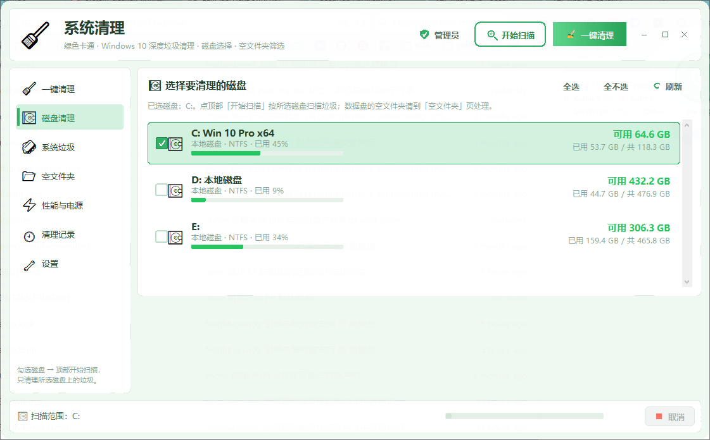
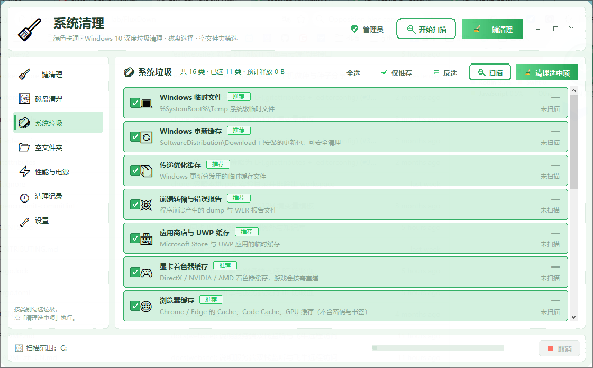
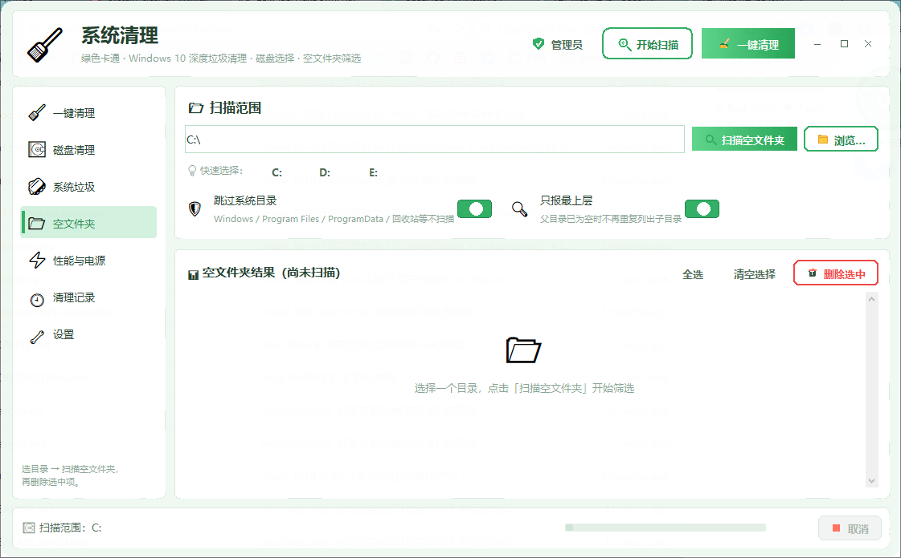
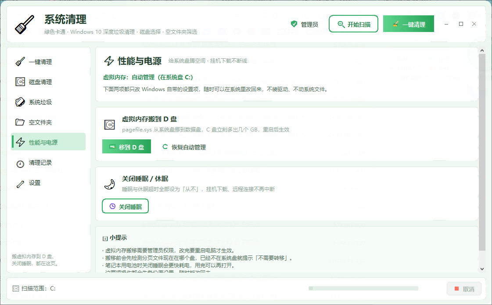

# 系统清理 · System Cleaner 🧹

绿色卡通风格的 **Windows 10 / 11 垃圾清理工具**，单文件 EXE、免安装、无广告、不联网。

C 盘又红了？点几下就能把临时文件、浏览器缓存、Windows 更新残留、崩溃转储这些"电子灰尘"扫干净。

---

## ✨ 功能

### 🧹 一键清理
- 点「开始扫描」先看能清多少，再点「一键清理」
- 16 类系统垃圾，按 **推荐 / 可选 / 谨慎** 三档分级
- 一键清理只动「推荐」项：回收站、Windows.old 这类"删了就回不来"的永远要你自己勾

### 💽 磁盘选择
- 想清哪个盘就勾哪个盘，扫描和清理只针对所选磁盘
- 每个盘显示卷标、文件系统、已用 / 总量、使用率进度条

### 📂 空文件夹筛选
- 扫描指定目录（或 C: / D: / E: 快速切换）下的空文件夹
- 默认跳过 Windows、Program Files 等系统目录
- 只要目录树里还有一个文件，整支都不动

### ⚡ 性能与电源（左侧导航 ⚡）
- **虚拟内存移到 D 盘**：把 pagefile.sys 从系统盘搬到数据盘，重启后生效，C 盘立刻多出几个 GB
  （v1.2.1 起会先检测分页文件当前在哪个盘，已经不在系统盘就直接提示「不需要转移」）
- **关闭睡眠**：睡眠 / 休眠超时全部设为「从不」，挂机下载、远程连接不再断
- 两者都只改系统设置，随时能在 Windows 里改回来；搬移前会自动备份原设置

### 🔄 自动升级（v1.2.0）
- 启动后静默检查一次新版本，**更新源：Gitee 主源 → GitHub 镜像**自动回退
- 也可以手动点「检查更新」，有新版会显示更新说明，一键下载后**覆盖原文件**并自动重启
- 下载支持 `sha256` 校验，文件不完整会自动换源重下

### 🎨 界面
- 绿色卡通主题 + 圆角卡片 + 胶囊按钮 + 彩色 emoji
- 半透明、圆角可开关；无系统灰色边框，标题栏按钮自绘
- 后台线程扫描 / 清理，界面不卡死

---

## 📥 下载

| 来源 | 地址 |
|---|---|
| Gitee（更新源） | <https://gitee.com/wenming760/system-cleaner/releases/download/v1.2.2/SystemCleaner.exe> |
| GitHub | <https://github.com/wenming758/system-cleaner/releases/download/v1.2.2/SystemCleaner.exe> |

单文件 EXE，不需要安装 Python 或运行库，拷贝到哪都能跑。
右键「以管理员身份运行」体验最完整（清 Windows 更新缓存、系统日志需要管理员权限）。

---

## 🖼 截图

| 首页 | 磁盘清理 |
|---|---|
|  |  |

| 系统垃圾 | 空文件夹 |
|---|---|
|  |  |

| 性能与电源（v1.2.0 独立成页） | 设置 |
|---|---|
|  |  |

| 窗口按钮悬停 | 关闭按钮悬停 |
|---|---|
|  |  |

---

## 📝 更新日志

### v1.2.2（2026-10-31）
- 修复：**升级时不停弹出 ping 黑窗口、升完版本还是旧的**。旧升级方式写个 `.bat` 等程序退出再覆盖文件，
  而 `DETACHED_PROCESS` 起的 cmd 没有控制台，里面每个 `ping` 都会各自弹一个黑窗口；
  加上退出前还弹着模态提示框，程序迟迟不退，覆盖连续失败 25 次后放弃 —— 什么都没换成
- 重构：升级改为**进程内直接替换**。Windows 只是不许删改正在运行的 EXE，**重命名是允许的**，
  于是「当前 EXE 改名 `.old` → 新文件写到原路径 → 按版本号改名 → 启动新程序」，实测 **0.08 秒**完成，
  不弹窗、不等待、不依赖批处理；`.old` 在下次启动时自动清理
- 优化：升级失败会把具体原因（复制失败 / 启动失败 / 改名失败）直接显示出来，不再只说「升级失败」
- ⚠️ **v1.2.0 / v1.2.1 自带的升级器本身是坏的**，它换不掉自己。用这两个版本的请手动下载 v1.2.2 覆盖一次；
  从 v1.2.2 起自动升级恢复正常
- 产物：`系统清理_v1.2.2.exe`

### v1.2.1（2026-10-31）
- 修复：**「虚拟内存移到 D 盘」报错**。改为直接写注册表
  `HKLM\SYSTEM\CurrentControlSet\Control\Session Manager\Memory Management\PagingFiles`，
  不再调用在 Win10 上会抛「常规故障」的 `Win32_PageFileSetting`；写完后自动复查，改不动会明确说明原因
- 新增：搬移前先**检测虚拟内存当前所在磁盘**。已经不在系统盘时直接提示「不需要转移」并阻止操作，
  免得把分页文件从一块数据盘倒腾到另一块、白占空间
- 修复：右上角出现**两套**最小化 / 最大化 / 关闭按钮。窗口改为「先隐藏 → 装好无边框钩子并摘掉
  `WS_CAPTION` → 再显示」，首帧就是无边框，不用刷新才正常
- 优化：虚拟内存操作失败的提示不再一律叫「设置失败」，而是把具体原因直接说清楚
- 产物：`系统清理_v1.2.1.exe`

### v1.2.0（2026-10-31）
- 新增：**「性能与电源」独立成左侧导航页 ⚡**，虚拟内存 / 睡眠相关操作一站直达
- 美化：右上角最小化 / 最大化 / 关闭按钮重绘为圆角方块，悬停浮出薄荷绿底色，关闭键悬停变实心红 + 白色叉，按下有反馈
- 优化：检测升级改为 **Gitee 主源 + GitHub 镜像**双源回退，一个连不上自动换另一个
- 优化：升级下载改为 **覆盖原文件**的增量升级，支持 `sha256` 校验，文件不完整自动换源重下
- 优化：输出文件按版本号命名（`系统清理_v1.2.0.exe`），不会和旧版本混淆

### v1.1.0（2026-10-31）
- 新增：一键把虚拟内存搬到 D 盘（含原设置备份、可恢复自动管理）
- 新增：一键关闭睡眠 / 休眠
- 新增：版本检查与自动升级（更新源：Gitee）
- 优化：去掉窗口最外圈的 1px 系统灰色边框，改成无边框窗口 + 自绘标题栏按钮（可拖动、可最大化）
- 修复：Win10 下「Windows 临时文件」的 emoji 显示成方块

### v1.0.0（2026-10-31）
- 首个版本：系统垃圾清理、磁盘选择、空文件夹筛选、清理记录、设置与高级工具

---

## 🔐 安全说明

- 只清 **白名单目录**：临时文件 / 缓存 / 日志，不碰桌面、文档、下载
- 被占用的文件自动跳过并计数，不强制删除
- 遇到 junction、符号链接一律不深入，避免顺着链接误删别的盘
- 程序自身目录、盘符根目录永远不会成为删除目标
- 清理前强制二次确认，列清楚要删什么
- 清理记录写在本地 `history\` 目录，**不联网、不上传**
- 修改虚拟内存 / 电源设置只动 Windows 自带配置，可随时改回

---

## ⚠️ 免责声明

本工具开源免费，按「现状」提供。清理类操作本身具有不可逆性，请在确认清单后使用；
因误删或系统设置变更造成的损失，作者不承担任何责任。

---

## 📄 许可

个人使用、学习、二次修改都可以，转载请注明出处。
